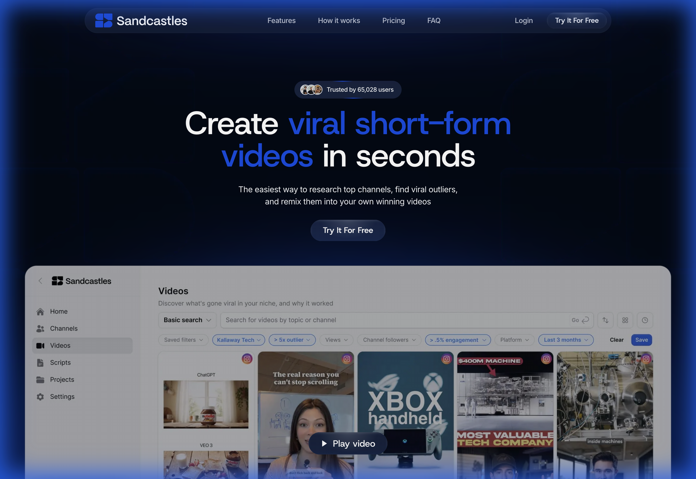
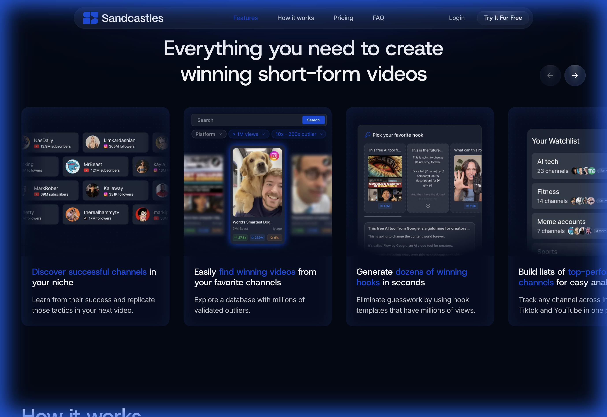
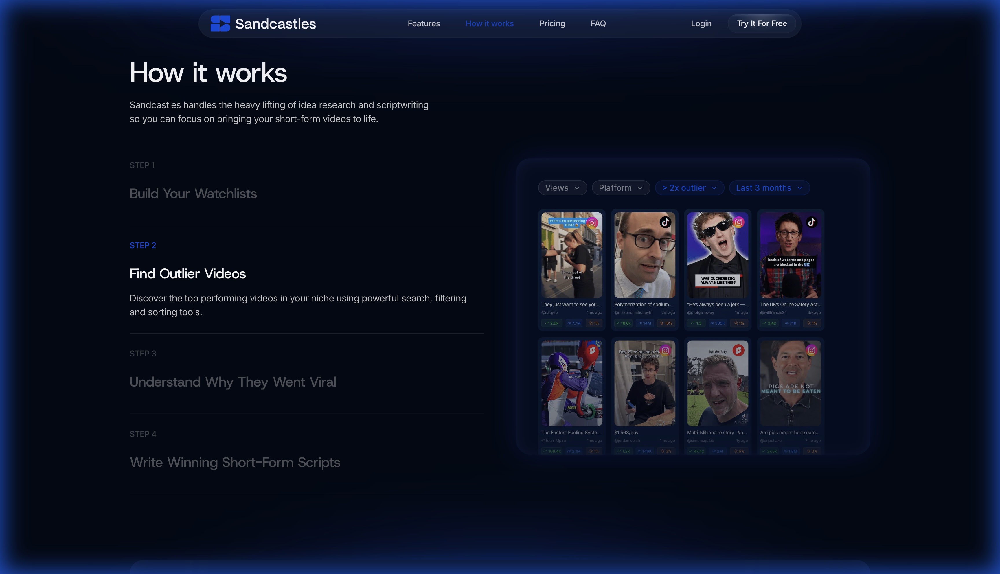
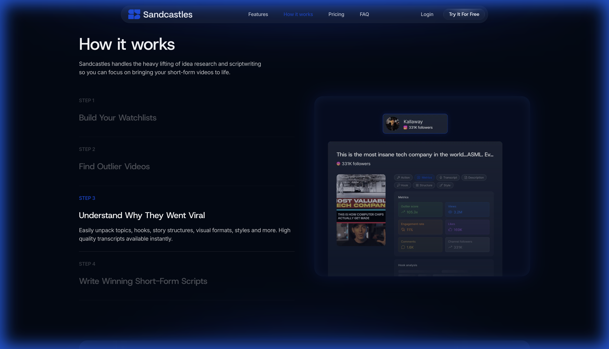
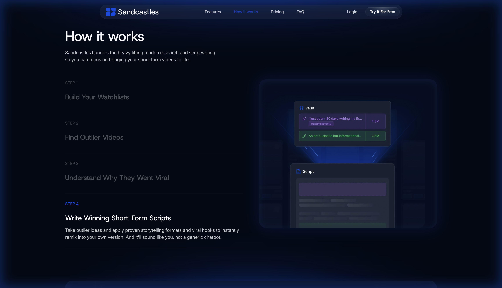
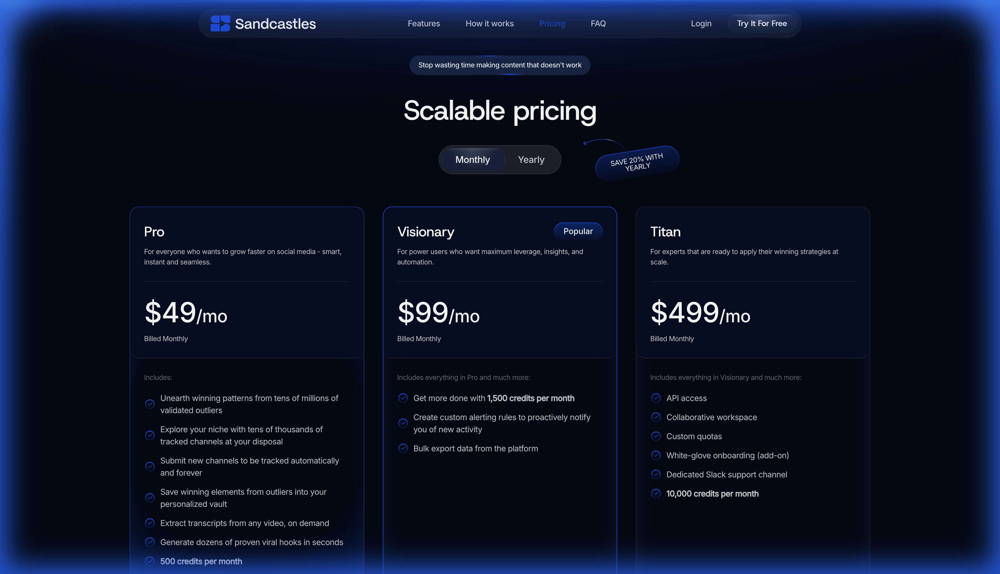
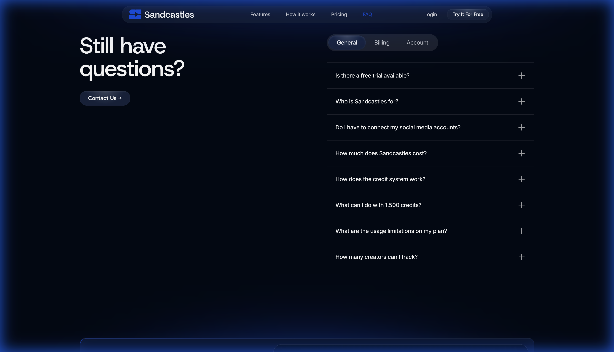

# Product Requirements Document (PRD): Sandcastles.ai Clone

## 1. Executive Summary
**Sandcastles.ai** is a data-driven content creation platform designed to help creators discover viral trends and generate high-performing scripts. It moves users from "gut feeling" creation to data-backed decisions by analyzing millions of videos to find "outliers"—content that significantly outperforms a channel's average. This PRD outlines the core features and user flows observed on the platform to serve as inspiration for CreatorOS.

## 2. Value Propositions
*   **Data-Driven, Not Intuition-Based:** Focuses on "Outlier" identification to prove what works before filming.
*   **Unified Research:** Consolidates research from YouTube, Instagram, and TikTok into one dashboard.
*   **Speed:** Reduces research and scripting time from hours to seconds.
*   **Personalization:** "Remixes" proven viral structures with the user's own voice/style.

## 3. User Flow
The platform is built around a 4-step "Viral Loop":
1.  **Build Watchlists:** Track competitors and top creators in specific niches.
2.  **Find Outliers:** Filter millions of videos to find those with high "Outlier Scores".
3.  **Understand:** Analyze *why* a video worked (hook, structure, transcript).
4.  **Write (Remix):** Use AI to rewrite the successful concept into a new, original script.

## 4. Key Features & Functional Requirements

### 4.1. Dashboard & Watchlists
*   **Functionality:** Users can create custom lists of channels to track.
*   **Data:** Displays aggregate stats for tracked channels.
*   **Adding Channels:** If a channel isn't in the DB, it can be requested and added within 30-60 mins.

### 4.2. Outlier Discovery Engine
*   **Search & Filter:** Advanced filters for views, engagement rate, date, and platform.
*   **Outlier Score:** A proprietary metric indicating performance relative to channel average (e.g., a "10x" outlier).
*   **Visual Feed:** Grid view of video thumbnails with overlay stats.

### 4.3. Deep Video Analysis
*   **Transcript Extraction:** One-click fetching of video transcripts.
*   **Hook Analysis:** Identifies the opening lines and visual hooks that grabbed attention.
*   **Structure Breakdown:** AI analyzes the pacing, segment breakdown, and key topics.

### 4.4. The Vault
*   **Personal Library:** Users can "save" specific videos, hooks, or transcript segments to their private vault.
*   **Organization:** Tags and folders to manage saved inspiration.

### 4.5. Script Remixing (AI Writer)
*   **Input:** User selects a saved "outlier" or transcript.
*   **Process:** AI rewrites the content using proven viral frameworks (e.g., "Problem-Agitate-Solve").
*   **Customization:** Adjusts tone and style to match the user's specific brand voice, avoiding generic "AI speak".

### 4.6. Credit System
*   **Currency:** "Credits" are used for high-value actions (adding channels, deep analysis, AI writing).
*   **UI:** Visible counter of available vs. used credits.

## 5. UI/UX & Design Aesthetic
*   **Theme:** Dark mode, clean, professional, "Cyberpunk/Data-Analyst" vibe. High contrast for metrics.
*   **Navigation:** Sidebar for main modules (Search, Vault, Watchlist).
*   **Interactivity:** Smooth transitions between "Research" and "Create" modes.

## 6. Visual References (Screenshots)

### Landing Page & Value Prop

### Core Features Overview

### User Flow: Step 2 (Find Outliers)

### User Flow: Step 3 (Analysis)

### User Flow: Step 4 (Script Writing)

### Pricing & Plans

### FAQ

## 7. Research Recording

